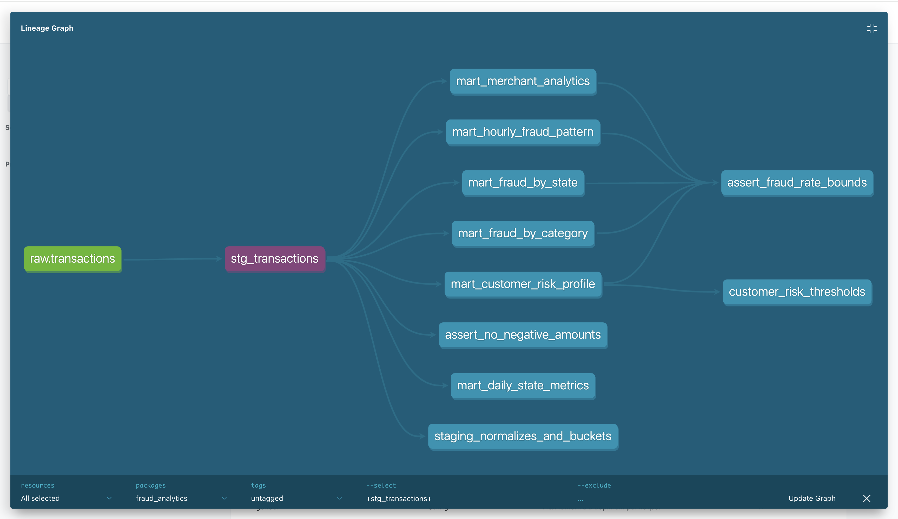

# dbt

Проект для анализа транзакций из дз по ClickHouse. Данные берутся из `../mlops_clickhouse/data/train.csv` и загружаются в таблицу `transactions_db.transactions`.

Модель `stg_transactions` приводит типы, убирает пробелы в строках и добавляет признаки для расчётов. На её основе создаются шесть таблиц с метриками в базе `analytics`.

## Запуск

Для запуска нужен Docker Compose. Команды выполняются из папки `mlops_dbt`:

```bash
make run
make load
make deps
make build
make test
make lint
make docs
make serve
```

После `make serve` документация доступна на http://localhost:8082. ClickHouse работает на http://localhost:8124.

`make load` очищает исходную таблицу и загружает CSV заново. Путь к другому файлу можно передать так: `make load CSV_PATH=/path/to/train.csv`.

Остановка контейнеров: `make down`. Загруженные данные при этом сохраняются.

## Витрины

| Модель | Что считает |
|---|---|
| `mart_daily_state_metrics` | Число и сумму операций, средний чек, P95 и долю крупных операций за день по каждому штату |
| `mart_fraud_by_category` | Количество и суммы операций, число и процент фрода по категориям |
| `mart_fraud_by_state` | Фрод и суммы по штатам, число уникальных клиентов и мерчантов |
| `mart_customer_risk_profile` | Первую и последнюю операцию клиента, средний чек и уровень риска |
| `mart_hourly_fraud_pattern` | Фрод по дням недели и часам |
| `mart_merchant_analytics` | Оборот и процент фрода у каждого мерчанта |

`fraud_rate` показывает процент мошеннических операций. Макрос `amount_bucket` делит суммы на SMALL (меньше 100), MEDIUM (от 100 до 1000, не включая 1000) и LARGE (от 1000). Доля крупных операций считается от 0 до 1.

Для риска взяты простые пороги: HIGH при доле фрода от 5%, MEDIUM от 1%, иначе LOW. У мерчантов и временных окон повышенный риск отмечается при доле фрода от 5%. Эти оценки рассчитаны по истории операций.

## Проверки и документация

В `schema.yml` описаны модели, колонки и проверки на пропуски, дубликаты и допустимые значения. Отдельные SQL-тесты проверяют отрицательные суммы и процент фрода. Два unit-теста проверяют обработку строк, границы сумм и пороги риска.

Из пакетов используются `dbt_utils` для ID и тестов, `dbt_date` для дня недели и `dbt_expectations` для проверки, что staging не пустой.

`make lint` проверяет SQL через SQLFluff. Чтобы запускать эту проверку перед коммитом, нужно установить `pre-commit` и выполнить `pre-commit install` из папки `mlops_dbt` внутри git-репозитория.

Все 37 тестов прошли. [Лог dbt test](results/dbt_test.log).

Версии: dbt-core 1.10.15, dbt-clickhouse 1.10.3.

`make docs` создаёт документацию. Её можно открыть через `make serve` или файлом `dbt/target/static_index.html`. Ниже скриншот графа из dbt Docs.


